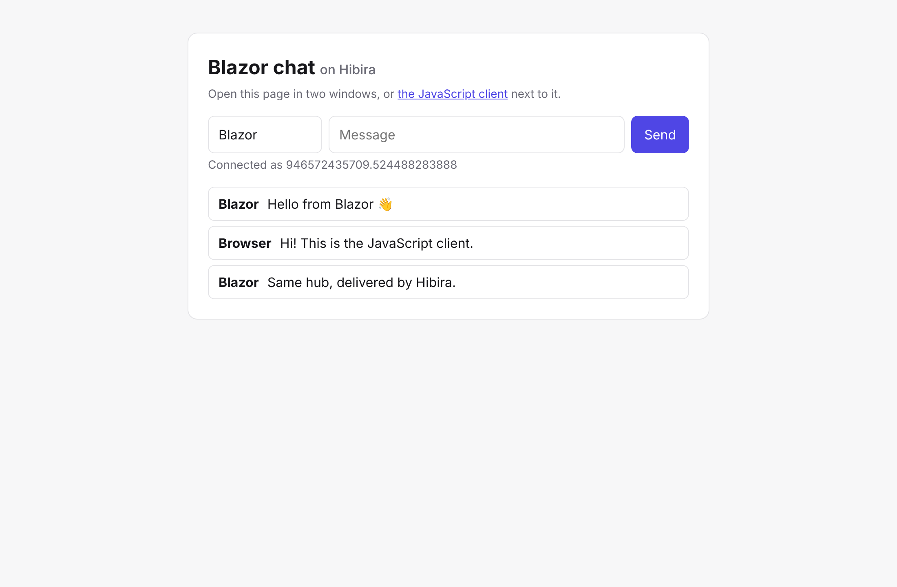
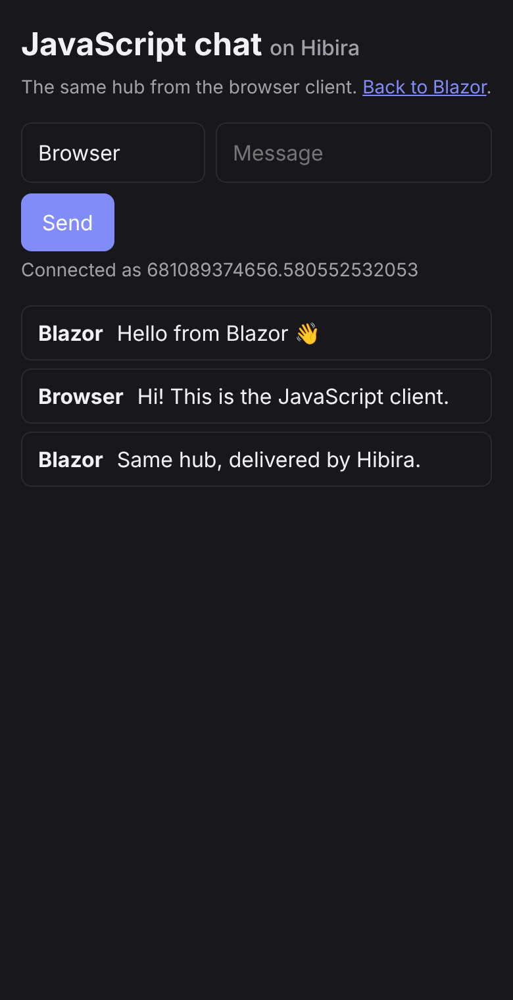

# Hibira for ASP.NET Core and Blazor

[](https://github.com/hibira-io/dotnet/actions/workflows/ci.yml)

Realtime hubs for ASP.NET Core and Blazor over [Hibira](https://hibira.io), with
the SignalR hub API you already know and no WebSocket server, backplane or
Azure SignalR Service to run.

Hibira is a hosted realtime service that speaks the Pusher Channels protocol.
`HibiraHub` looks like SignalR's `Hub`: `Clients.All.SendAsync(...)`,
`Groups.AddToGroupAsync(...)`, `Clients.User(...)`, typed hubs and
`IHubContext<THub>` all work the same way. Your server keeps handling hub
calls; Hibira holds the WebSocket connections and fans messages out.

| Package | What it is |
| --- | --- |
| `Hibira.AspNetCore` | `HibiraHub`, `MapHibiraHub<T>()`, `IHubContext<T>`, webhooks, and the browser client `hibira-hub.js` |
| `Hibira.Client` | .NET client for Blazor WebAssembly, Blazor Server, MAUI and console apps (the SignalR client API) |
| `Hibira` | HTTP API client: trigger events, sign channels and users, verify webhooks, approvals |

Supports .NET 8 and later.



## Install

```sh
dotnet add package Hibira.AspNetCore
dotnet add package Hibira.Client   # for Blazor or other .NET clients
```

Copy the app ID, key and secret from your app page on
[hibira.io/portal](https://hibira.io/portal) (the free plan needs no card) into
configuration, for example user secrets or environment variables:

```sh
dotnet user-secrets set Hibira:AppId your-app-id
dotnet user-secrets set Hibira:Key your-app-key
dotnet user-secrets set Hibira:Secret your-app-secret
# or HIBIRA__APPID, HIBIRA__KEY, HIBIRA__SECRET
```

The secret is shown only once, when you create the app; the app ID and key
stay under Overview → Credentials. Apps outside the default region also set
`Hibira:Host` (`ws-<cluster>.hibira.io`). On the Free plan, allowed origins
can't be `*`: add every origin your pages load from (`https://localhost:5001`
while developing, plus your production domain), or browsers are refused.

## A hub

```csharp
using Hibira.AspNetCore;

public class ChatHub : HibiraHub
{
    public async Task SendMessage(string user, string message) =>
        await Clients.All.SendAsync("ReceiveMessage", user, message);
}
```

```csharp
builder.Services.AddHibira();            // reads the "Hibira" section

var app = builder.Build();
app.UseStaticFiles();                    // serves hibira-hub.js
app.MapHibiraHub<ChatHub>("/hubs/chat");
```

## Blazor (and any .NET client)

```razor
@using Hibira.Client
@inject NavigationManager Navigation
@implements IAsyncDisposable

@code {
    private HubConnection? hubConnection;
    private readonly List<string> messages = new();

    protected override async Task OnInitializedAsync()
    {
        hubConnection = new HubConnectionBuilder()
            .WithUrl(Navigation.ToAbsoluteUri("/hubs/chat"))
            .WithAutomaticReconnect()
            .Build();

        hubConnection.On<string, string>("ReceiveMessage", (user, message) =>
        {
            messages.Add($"{user}: {message}");
            InvokeAsync(StateHasChanged);
        });

        await hubConnection.StartAsync();
    }

    private Task Send(string user, string text) => hubConnection!.SendAsync("SendMessage", user, text);

    public async ValueTask DisposeAsync()
    {
        if (hubConnection is not null) await hubConnection.DisposeAsync();
    }
}
```

That is Microsoft's SignalR Blazor tutorial with one `using` changed. It runs
in Blazor WebAssembly as is. In Blazor Server the component's connection is
made from the server, so it doesn't carry the browser's cookies: use
anonymous hubs there, or pass `o.AccessTokenProvider` / `o.Headers` in
`WithUrl`. With prerendering on, `OnInitializedAsync` runs twice; turn it off
for the component (`new InteractiveServerRenderMode(prerender: false)`) or
start the connection in `OnAfterRenderAsync`.

## JavaScript

```html
<script src="https://cdn.jsdelivr.net/npm/pusher-js@8.4.0/dist/web/pusher.min.js"></script>
<script src="_content/Hibira.AspNetCore/hibira-hub.js"></script>
<script>
  const connection = new hibira.HubConnectionBuilder()
    .withUrl("/hubs/chat")
    .withAutomaticReconnect()
    .build();

  connection.on("ReceiveMessage", (user, message) => console.log(user, message));
  await connection.start();
  await connection.invoke("SendMessage", "ann", "hello");
</script>
```

`hibira` has the same shape as `signalR` from `@microsoft/signalr`: `on`,
`off`, `start`, `stop`, `invoke`, `send`, `onclose`, `onreconnecting`,
`onreconnected`, `state` and `connectionId`. Pass `accessTokenFactory` or
`headers` to `withUrl` for bearer tokens.



## Everything a hub can do

```csharp
[Authorize]
public class GameHub : HibiraHub
{
    public Task Move(int x, int y) => Clients.Others.SendAsync("Moved", Context.UserIdentifier, x, y);
    public Task Ping() => Clients.Caller.SendAsync("Pong");
    public async Task JoinRoom(string room)
    {
        await Groups.AddToGroupAsync(Context.ConnectionId, room);
        await Clients.OthersInGroup(room).SendAsync("Joined", Context.UserIdentifier);
    }
    public Task Whisper(string userId, string text) => Clients.User(userId).SendAsync("Whisper", text);
    public int Roll() => Random.Shared.Next(1, 7);              // returned to InvokeAsync<int>
    [Authorize(Roles = "admin")] public Task Kick(string id) => Clients.Client(id).SendAsync("Kicked");
    public void Cheat() => throw new HubException("nice try");  // the message reaches the caller

    public override Task OnConnectedAsync() => Clients.All.SendAsync("Online", Context.UserIdentifier);
    public override Task OnDisconnectedAsync(Exception? e) => Clients.All.SendAsync("Offline", Context.UserIdentifier);
}
```

Typed hubs and sending from anywhere else:

```csharp
public interface IGameClient { Task Moved(string user, int x, int y); }
public class TypedGameHub : HibiraHub<IGameClient> { /* Clients.All.Moved(...) */ }

public class ScoresController(IHubContext<GameHub> hub) : ControllerBase
{
    [HttpPost] public Task Post(Score s) => hub.Clients.Group(s.Room).SendAsync("Score", s);
}
```

Hub methods get services injected as parameters, a `CancellationToken`, and
`Context.User`, `Context.UserIdentifier` (the NameIdentifier claim; change it
with `HibiraHubOptions.UserIdProvider`) and `Context.GetHttpContext()`.

## Moving from SignalR

1. Swap `using Microsoft.AspNetCore.SignalR;` for `using Hibira.AspNetCore;`
   and `Hub` for `HibiraHub` (`Hub<T>` for `HibiraHub<T>`).
2. Swap `AddSignalR()` for `AddHibira()`, `MapHub<T>` for `MapHibiraHub<T>`,
   and drop the Azure SignalR or Redis backplane.
3. In .NET clients, swap the `Microsoft.AspNetCore.SignalR.Client` package
   for `Hibira.Client` (`using Hibira.Client;`). In the browser, load
   pusher-js and `hibira-hub.js` and use `hibira.` where you used `signalR.`.

What is different:

| | SignalR | Hibira |
| --- | --- | --- |
| Client → server calls | over the WebSocket | HTTPS POST to your app (same auth, cookies and policies) |
| Server → client messages | your server holds every socket | Hibira holds the sockets; your server makes one HTTPS call per message |
| `AllExcept`, `GroupExcept` | any number of IDs | at most one ID per message |
| Message size | 32 KB by default | 10 KB (4 KB on Free) per message |
| Groups | in the hub's memory | the connection store (memory, or IDistributedCache with several servers) |
| Client results, streaming, MessagePack | yes | not yet |

Like SignalR, a reconnect gets a new connection ID, and groups have to be
joined again (`Reconnected` / `onreconnected` is the place).

## Webhooks: hear about every disconnect

`StopAsync` and closing the page tell the hub right away. For connections that
just drop (a phone losing signal), map the webhook endpoint and add its URL in
the Hibira portal with the **channel_vacated** event:

```csharp
app.MapHibiraWebhooks("/hibira/webhooks", async (e, services) =>
{
    // every verified event also arrives here, if you want them
});
```

Signatures are checked, including the previous secret while a rotated secret
is in its grace period.

## Several servers

Group memberships live in memory by default. Behind a load balancer, store
them in any `IDistributedCache`:

```csharp
builder.Services.AddStackExchangeRedisCache(o => o.Configuration = "...");
builder.Services.AddHibira().AddDistributedConnectionStore();
```

## The HTTP API on its own

```csharp
var hibira = app.Services.GetRequiredService<IHibiraClient>();   // or new HibiraClient(options)

await hibira.TriggerAsync("orders", "order-shipped", new { id = 42 });
await hibira.SendToUserAsync("ann", "notification", new { text = "Hi" });
var channels = await hibira.GetChannelsAsync(prefix: "presence-");

// Your own private and presence channels for pusher-js clients:
var auth = hibira.AuthorizePresenceChannel(socketId, "presence-room-1", userId, new { name });

// Ask a person for a decision and wait for the answer:
var approval = await hibira.RequestApprovalAsync(new() { Title = "Refund order #1042 for $89?" });
// share approval.Url, then:
approval = await hibira.GetApprovalAsync(approval.ApprovalId, wait: TimeSpan.FromSeconds(25));
```

## How it works

Each hub has a private channel for everyone (`private-hibira.<hub>`), one per
connection (`.c.<connection id>`) and one per group (`.g.<group>`); users get
Hibira's `#server-to-user-<id>` channel through sign-in. `MapHibiraHub` adds
these endpoints under the hub path: `negotiate`, `auth` and `user-auth` (it
signs only the channels a connection may join: its own connection channel,
and groups the hub added it to), `handshake`, `connect`, `invoke` and
`disconnect`. The connection token that `invoke` needs is delivered over the
connection's own channel, so only the real socket can use it, and it is bound
to the signed-in user. Messages are sent as events named after the client
method, with `{"hub": "...", "arguments": [...]}` as data.

## Sample

[`samples/BlazorChat`](samples/BlazorChat) is a Blazor Web App chat with a
JavaScript page on the same hub:

```sh
cd samples/BlazorChat
dotnet user-secrets init
dotnet user-secrets set Hibira:AppId ... # Key, Secret too
dotnet run
```

## Development

```sh
dotnet test                                        # unit and hub tests
npm install --prefix tests/Hibira.E2E/js
E2E_HOST=ws.hibira.io E2E_PORT=443 E2E_TLS=1 E2E_APP_ID=... E2E_KEY=... E2E_SECRET=... \
  dotnet run --project tests/Hibira.E2E              # two .NET clients and hibira-hub.js against a real app
```

## License

MIT

## 中文摘要

`Hibira.AspNetCore` 讓 ASP.NET Core 與 Blazor 透過 Hibira 使用和 SignalR
相同的 Hub API(`Clients.All`、`Groups`、`Clients.User`、強型別 Hub、
`IHubContext`),不需要自己架 WebSocket 伺服器、backplane 或 Azure SignalR
Service。從 SignalR 移轉時,只要把 `Hub` 換成 `HibiraHub`、`MapHub` 換成
`MapHibiraHub`,.NET 用戶端換成 `Hibira.Client`,瀏覽器改用 pusher-js 加
`hibira-hub.js`。用戶端呼叫伺服器方法走 HTTPS(沿用你的驗證與授權),
伺服器送出的訊息由 Hibira 負責推送。差異:`AllExcept` 一次只能排除一個連線、
每則訊息上限 10 KB(Free 方案 4 KB)。多台伺服器時請用
`AddDistributedConnectionStore()`;要即時得知斷線,請在 Hibira 主控台設定
channel_vacated webhook 並 `MapHibiraWebhooks`。
